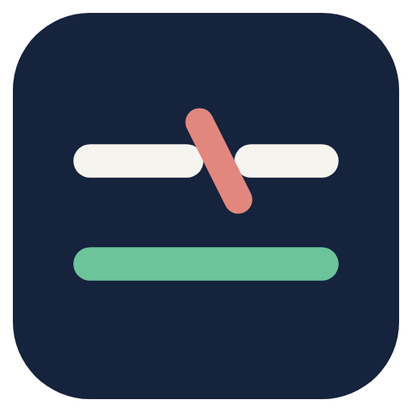

# MakeWhole

**Refunds after a protocol incident, computed from the liquidation events themselves, under terms frozen before anyone
files, and paid on GenLayer.** v2: any sponsor, three protocol templates, five chains, a keeper that files every event,
reconciliation against the sponsor's own list, and payouts proven at the recipient.

| | |
|---|---|
| **Live app** | https://makewhole-ledger.vercel.app |
| **Network** | GenLayer Studio Dev, chain `61997` ([explorer](https://explorer-studio-dev.genlayer.com/)) |
| **MakeWholeV2, canonical** (the real incidents; windows from 1 h) | `0xBb2397667aF1dB87497A6794B36f2e14ECfA394c` |
| **MakeWholeV2, demo** (same source; windows from 60 s) | `0x65AD8233033ee9a46366B8671d6C9Df36FB6B117` |
| **RecoveryGate** (reads the canonical contract; no payable method) | `0x01990f29Dd25604219c63E2b9e94B09957E8B52e` |
| **RecoveryGate, demo** | `0x7555D03dE33f3fC8C586f0B2AE5Fe3BC1CD9f125` |
| **Deployed from** | [`b52bb22`](https://github.com/kenil1710/makewhole/tree/b52bb2278495661fa8eb47da9e1bfcc003c2e967) (all four, one commit; `node tools/verify_source.mjs` or [/verify](https://makewhole-ledger.vercel.app/verify)) |
| **Tests** | `sh test/run_all.sh`: v1's 117 (unchanged) + 325 new (228 contract, 51 meaning, 46 keeper) |
| **Milestone** | [docs/MILESTONE.md](docs/MILESTONE.md) (BASE proof, every feature with pinned links) · [final check](docs/FINAL_CHECK.md) · [attack round](docs/ATTACK_REPORT_V2.md) · [seeds](docs/SEEDS_V2.md) · [rules](docs/RULES_V2.md) |
| **v1** (the accepted submission, still on chain, untouched) | [docs/superseded/v1.3/README.md](docs/superseded/v1.3/README.md) |

## Scope

MakeWhole computes refunds from on-chain events under frozen terms. It does not decide who caused an incident, and it
does not judge whether a liquidation was fair: the sponsor's terms say which events count and how much each is owed,
and code applies them. Only the listed templates and chains count: Aave v3 `LiquidationCall` (including SparkLend),
Compound v3 `AbsorbCollateral` and Morpho Blue `Liquidate`, emitted by the official contracts on Ethereum, Arbitrum,
Base, Optimism and Polygon ([the full registry](docs/RULES_V2.md#official-emitters)). Refunds are paid in GEN on
GenLayer Studio Dev to the borrower address recorded in each event.

## How it works

1. **Open (sponsor).** One transaction freezes the template, the chain, the official emitters (checked against the
   contract's registry; Morpho market ids are recomputed from their parameters with keccak256), the block range, the
   filters (collateral and debt assets, a minimum amount, an optional price-source condition), the formula from a fixed
   menu, the RPC endpoints, the terms text (stored with its sha256), the sponsor's official reimbursement list if there
   is one (its sha256 must be quoted in the terms), the claim deadline and the claim window, and funds the pool. Before
   the first filing the sponsor may amend (never shortening a window); after it, only `top_up` and `extend_deadline`.
2. **File (anyone; the keeper).** `file_event(incident, tx, log index)`. Every validator reads the receipt from every
   frozen endpoint, each tagged with its chain id and whether the block is final there; a value counts only if two
   endpoints return it identically and none disagrees. Code decodes the log with the template's decoder and refuses
   (nothing recorded) a wrong chain, a failed transaction, another emitter, another Morpho market, a block outside the
   range or not final, a duplicate. Otherwise it records the event as `ELIGIBLE` with the amount, or `NOT_ELIGIBLE`
   with the reason (collateral or debt asset not covered, price-source condition not met, below the minimum). Each
   (chain, tx, log index) counts once per incident; the payee is always the borrower in the log.
3. **Claim (anyone).** From the claim deadline until the end of the window, `claim(incident, borrower)` pushes the
   borrower's entitlement to the borrower's address with an external value message whose fee the caller pays.
   `entitled = owed` if the pool covers the total, else `floor(owed × pool / total)`: the same whatever the order of
   claims; a top-up raises every entitlement and an already-paid account can be paid the difference.
4. **Refund (anyone).** `refund_surplus` returns the part of the pool above the total owed to the sponsor after the
   claim deadline; `close` returns everything still held (unclaimed refunds, flooring dust) after the claim window.
   Books equal `eth_getBalance` after every method; nothing can stay in the contract.
5. **Ask (any protocol).** `RecoveryGate.status(incident, account)`: `NO_INCIDENT`, `NOT_ELIGIBLE`, `ELIGIBLE_UNPAID`,
   `PAID` (with `made_whole`), `CLOSED`, or `UNAVAILABLE` when anything is missing or inconsistent, never a favourable
   guess.

No model is called anywhere in v2: code decides every number and every verdict.

## The keeper

[`tools/keeper.mjs`](tools/keeper.mjs) runs every hour on [GitHub Actions](.github/workflows/keeper.yml). For every open
incident it walks the block range with `eth_getLogs` page by page (each page read from two endpoints and merged),
persisting a cursor per incident and emitter on the [`keeper-state`](https://github.com/kenil1710/makewhole/tree/keeper-state)
branch, files each event, stores the transaction hash before waiting on it, and counts a filing only when the
transaction is FINALIZED, executed without error, and `find_filing` returns it. Transient failures go to a retry queue
with backoff; permanent refusals are kept with their reason. Nothing is dropped: the
[keeper page](https://makewhole-ledger.vercel.app/keeper) lists every event that is not filed and why, and a coverage
line per incident (found, filed, eligible, paid, unclaimed).

## The incidents

| Incident | Chain · template | Events | Source |
|---|---|---|---|
| Aave v3 wstETH CAPO oracle misconfiguration, 10 March 2026 | Ethereum · Aave v3 (Core and Prime) | 49 | [Aave governance](https://governance.aave.com/t/direct-to-aip-wsteth-capo-oracle-incident-user-reimbursement/24275); official list = the Aave Finance Committee payout |
| Morpho Blue cbETH/WETH (94.5% LLTV), Pyth push-feed skew, 2 March 2025 | Base · Morpho Blue | 3 | [RE7 Labs incident report](https://forum.morpho.org/t/pyth-cbeth-price-feed-is-easily-manipulated-resulted-in-me-losing-33000/1577) |
| Morpho Blue ezETH/WETH markets, ezETH depeg, 24 April 2024 | Ethereum · Morpho Blue | 146 | [Gauntlet market update](https://forum.morpho.org/t/gauntlet-lrt-core-vault-market-update-4-24-2024-ezeth-price-volatility/578) |

Each event count matches the post-mortem (the RE7 report names the three Base transactions; Gauntlet counts 138 + 8).
Results, reconciliation and every payout: [docs/SEEDS_V2.md](docs/SEEDS_V2.md).

## Repository

| Path | What |
|---|---|
| [`contracts/MakeWholeV2.py`](contracts/MakeWholeV2.py) | The incident engine |
| [`contracts/RecoveryGate.py`](contracts/RecoveryGate.py) | The read-only consumer |
| [`contracts/MakeWhole.py`](contracts/MakeWhole.py), [`RecoveryLedger.py`](contracts/RecoveryLedger.py) | v1, unchanged since BASE |
| [`incidents/v2/`](incidents/v2) | The three canonical configs and terms (`tools/make_incidents.py`) |
| [`tools/`](tools) | keeper, deploy, seeds, `verify_source.mjs`, `final_check.mjs`, `rules_md.py`, `base_proof.mjs` |
| [`test/v2/`](test/v2) | The three new test layers; real receipts in `test/v2/fixtures/` |
| [`research/`](research) | RPC probes, the emitter registry check, live probes |
| [`frontend/`](frontend) | The site (Next.js) |
